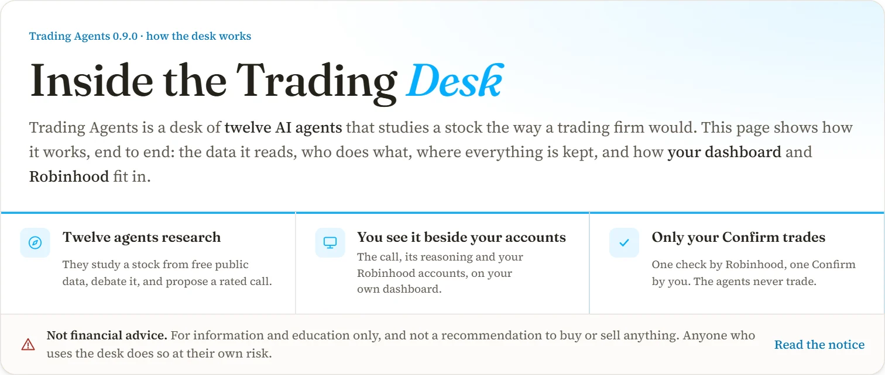
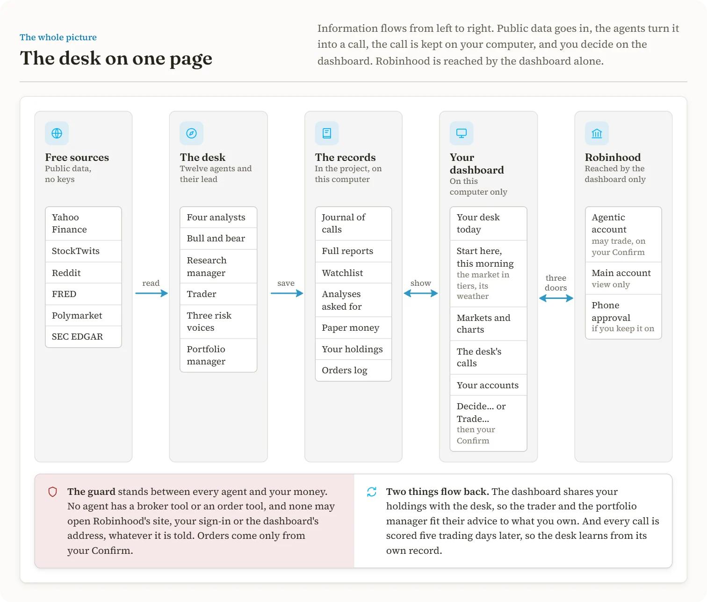
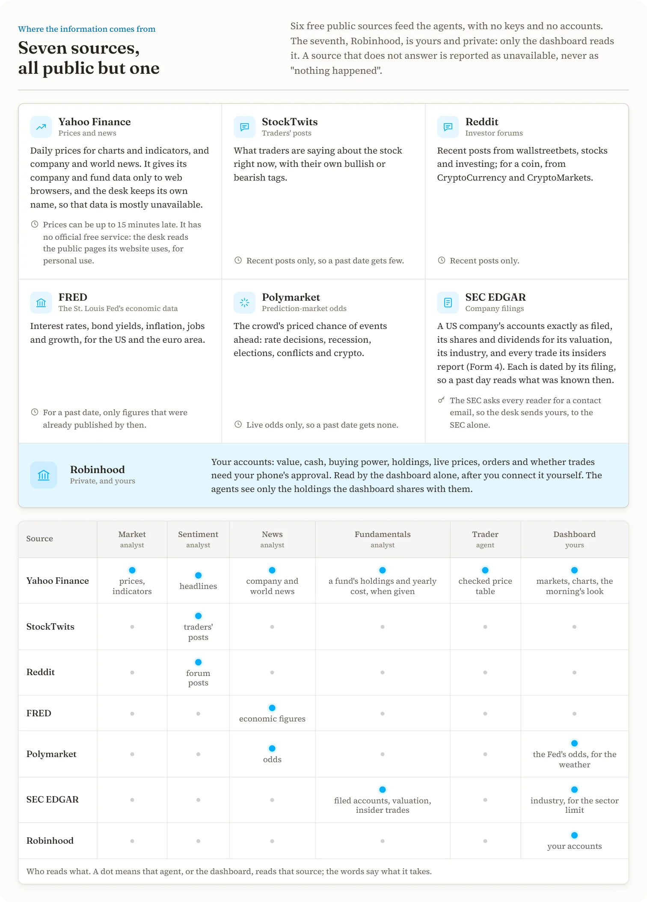
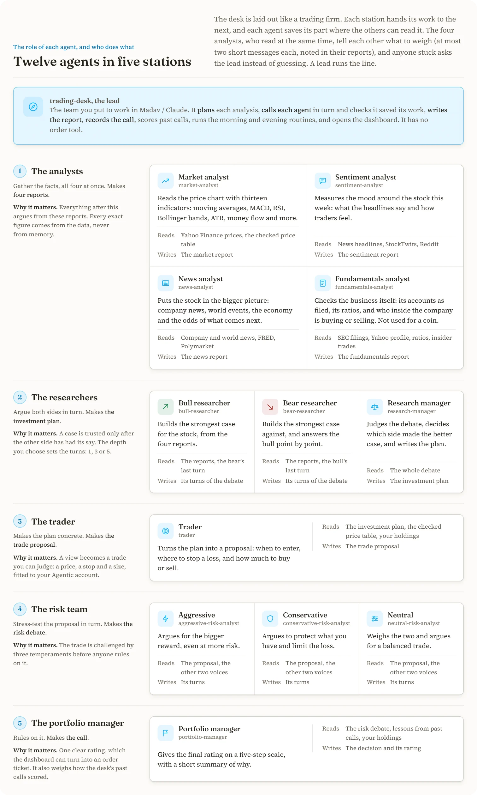
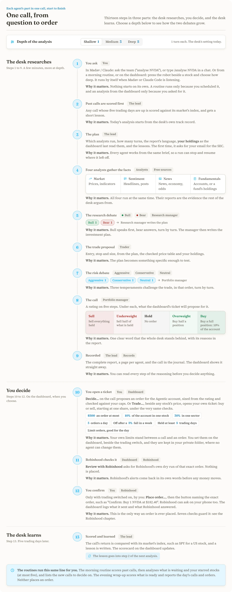
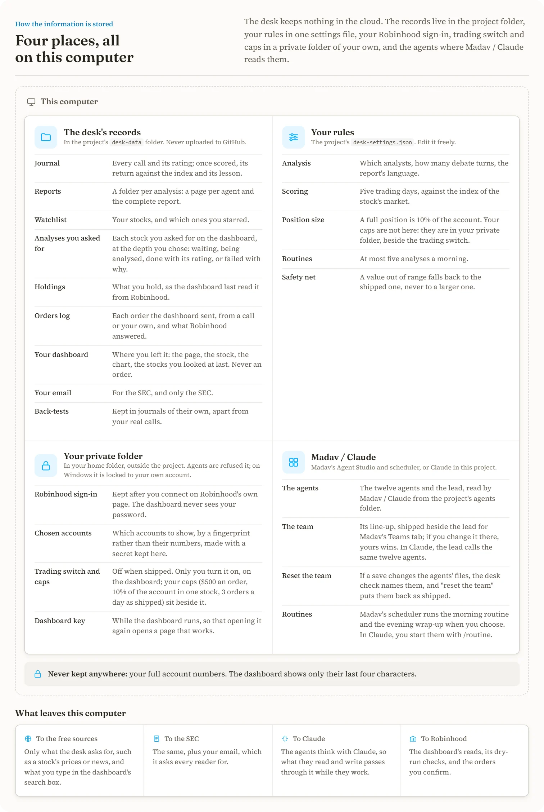
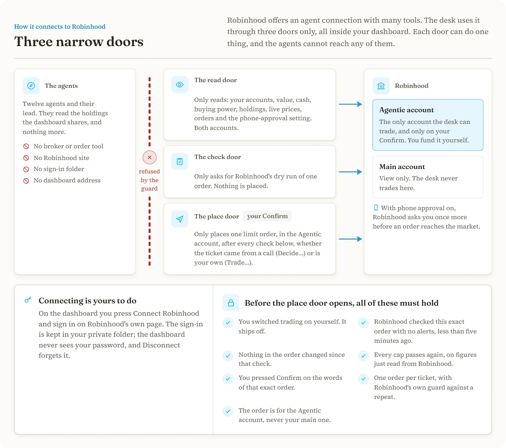
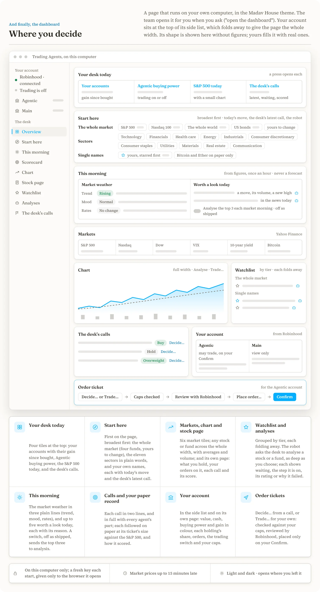

# Trading Agents

<a href="https://madavai.github.io/Trading-Agents/inside-the-trading-desk.html">
<picture>
  <source media="(prefers-color-scheme: dark)" srcset="docs/readme/hero-dark.webp">
  
</picture>
</a>

A trading desk of AI agents for [Madav](https://github.com/madavai) / Claude, built in the open. A team of agents
analyses a stock the way a trading firm would; you see their call on a dashboard beside your own Robinhood accounts; and
if you decide to act, you place the order through Robinhood's agent connection with one review and one confirm. The
agents never trade. You do.

> [!CAUTION]
> **Not financial advice.** Trading Agents is a personal, open-source project for learning and research, not a
> financial service. A rating such as Buy or Sell is the output of AI agents: not a recommendation, an offer or a
> solicitation. AI can be wrong, the past is no promise, and you can lose money. Every order is yours, and anyone who
> uses the desk does so at their own risk. [Read the full notice](#not-financial-advice).

The pictures on this page come from the visual guide,
**[Inside the Trading Desk](https://madavai.github.io/Trading-Agents/inside-the-trading-desk.html)**: press any of them
to open that part of the guide. They follow your light or dark theme.

> [!NOTE]
> **Every part is built** - the desk check, the free data tools, the twelve-agent team with its scoring and lessons,
> back-testing, the dashboard with your Robinhood accounts, order tickets with Robinhood's own check, placing an order
> on your Confirm, the morning and evening routines, and the trading-desk team in Madav's Agent Studio.
> **Being proven now, on a real computer:** a full analysis with company accounts, the dashboard with a real Robinhood
> account, and a first real order. Until that is done, keep trading switched off, or keep orders to one share with
> Robinhood's phone approval on.

Adapted from [TradingAgents](https://github.com/TauricResearch/TradingAgents) by Tauric Research (see `NOTICE`); not
affiliated with them.

## The desk on one page

<a href="https://madavai.github.io/Trading-Agents/inside-the-trading-desk.html#glance">
<picture>
  <source media="(prefers-color-scheme: dark)" srcset="docs/readme/glance-dark.webp">
  
</picture>
</a>

## Start in three steps
1. In Madav, clone this repository. There is nothing to install.
2. Open **Agent Studio**: the **trading-desk** team and its twelve agents are there, ready. If Madav asks whether to use
   this folder's tools, say yes.
3. Ask the team to check this computer, then to analyse a stock ("analyse NVDA") or to open the dashboard. The first
   check looks at your computer and the free data sources and asks for your email (once). In a Claude Code chat in this
   folder the same desk answers to `/desk-check`, `/analyse NVDA` and `/terminal`.

You need Node 22 or later (Madav needs it too). No keys and no installs; only your email, once.

**If the team was changed by mistake:** saving the trading-desk team in Agent Studio can rewrite the project's agent
files. The desk check notices and names them; ask the team to "reset the team" and, on your yes, it puts them back
exactly as the project ships them.

## Where the information comes from

<a href="https://madavai.github.io/Trading-Agents/inside-the-trading-desk.html#sources">
<picture>
  <source media="(prefers-color-scheme: dark)" srcset="docs/readme/sources-dark.webp">
  
</picture>
</a>

The sources, in words

Free public sources, with no keys: Yahoo Finance (prices, news, company profile), StockTwits, Reddit, FRED (economic
figures), Polymarket (odds) and SEC EDGAR (company filings). Yahoo Finance has no official free service: the desk reads
the same public pages its website uses, for personal use, and Yahoo can block or change them without notice. Any source
that does not answer is reported as unavailable, never as "nothing happened". Market prices may be up to 15 minutes
late.

**Why your email:** the SEC asks everyone who reads its filings for a contact address, so the desk needs yours before
its first analysis. It is kept in this folder's `desk-data` (which git never commits) and sent to the SEC alone; no
other source sees it.

## Who does what: twelve agents

<a href="https://madavai.github.io/Trading-Agents/inside-the-trading-desk.html#agents">
<picture>
  <source media="(prefers-color-scheme: dark)" srcset="docs/readme/agents-dark.webp">
  
</picture>
</a>

Choose `shallow`, `medium` or `deep` (1, 3 or 5 rounds of debate), which analysts run, and the report language.

The agents talk only when it does work the written record cannot. The four analysts read at the same time, so when one
finds something another should weigh ("a recall was announced on the 14th: weigh the reaction since then"), it says
so: at most two short messages each, pointing at a source or a date, never a figure of their own, and each noted in the
sender's report so you see it on the dashboard. Any member that is stuck asks the lead instead of guessing. In Madav,
the team's "talk" switch shows these messages in the Messages panel; with it off, the team works in silence.

## One call, from question to order

<a href="https://madavai.github.io/Trading-Agents/inside-the-trading-desk.html#journey">
<picture>
  <source media="(prefers-color-scheme: dark)" srcset="docs/readme/journey-dark.webp">
  
</picture>
</a>

The same, in words

1. **Agents analyse.** Ask the trading-desk team in Agent Studio ("analyse NVDA"), type `/analyse NVDA` in a chat, or
   press the robot beside a stock on the dashboard (see "Analyses that run by themselves" below).
   Four analysts (price and indicators, mood, news, company accounts or, for a fund, what it holds and what it costs
   each year), a bull and a bear, a research manager, a trader,
   three risk voices and a portfolio manager work in turn, from free public data, and give a rating. Each call is scored
   a few trading days later against its market's index (`/settle`), and the lessons go into later analyses.
   `/backtest NVDA,AAPL 2026-06-01 2026-08-01` runs the team over past dates in a journal of its own and reports, by
   rating, how often the direction was right and the mean alpha. It is slow and uses a lot of model time, and for past
   dates only prices, indicators, economic figures and SEC accounts are as known then: news, posts, odds and insider
   trades are recent-only, so they are thin.
2. **You see.** Ask the team to open the dashboard, or type `/terminal`: a page on your own computer with the markets,
   a chart of any stock (area or candles, 50- and 200-day averages, volume), your watchlist, a page per stock, the
   desk's calls with their full reasoning, and how the desk has scored. The agents see your chosen holdings when they
   analyse.
3. **You decide and trade.** On a call, "Decide…" opens a ticket for the Agentic account, sized by your settings and
   checked against your caps; beside a stock's price, "Trade…" opens your own ticket instead, buy or sell, starting at
   one share. Either way "Review with Robinhood" is Robinhood's own dry run, and with trading switched on (by you, on
   the dashboard), "Place order…" then "Confirm: Buy 1 NVDA at $182.40" sends exactly that order. Trading ships
   switched off.

## Where everything is kept

<a href="https://madavai.github.io/Trading-Agents/inside-the-trading-desk.html#kept">
<picture>
  <source media="(prefers-color-scheme: dark)" srcset="docs/readme/kept-dark.webp">
  
</picture>
</a>

## How Robinhood fits in

<a href="https://madavai.github.io/Trading-Agents/inside-the-trading-desk.html#robinhood">
<picture>
  <source media="(prefers-color-scheme: dark)" srcset="docs/readme/robinhood-dark.webp">
  
</picture>
</a>

### Safety
- No agent uses a broker connection. A guard refuses every broker tool, every tool that speaks of trading or moving
  money, Robinhood's site, and the dashboard's own address, whatever an agent was told. No agent, and no one on the
  trading-desk team, has a Robinhood tool or an order tool.
- Only the dashboard talks to Robinhood, through three narrow doors: one that only reads, one that only asks for
  Robinhood's dry-run check, and one that places a single limit order. The last is used only when trading is switched
  on (by you), on a ticket Robinhood checked with no alerts in the last five minutes and unchanged since, after your
  Confirm naming the exact order, and after every cap is checked again on fresh figures. A ticket sends one order.
- Your caps and guard rails are yours alone. As shipped: $500 an order, 10% of the account in one stock, 30% in one
  sector, 5% in crypto, 3 orders a day; trading switches itself off after a 5% fall in a week (from the week's
  highest value, with the reason on the page); and a stock bought here is held at least 5 trading days before the desk
  proposes selling it (your own early sell takes one more press). You change them on the dashboard's "Your account"
  page, beside the trading switch, and they are kept with it in your private folder, where agents are refused, never
  in the project's files. A value out of range falls back to the shipped one, never to a larger one. A sector comes
  from the company's own profile; whole-market funds count towards none, the S&P sector funds towards theirs, and a
  stock whose sector is not known counts as its own. Paper follows the same rules. A full position is 10% of the
  account (`desk-settings.json` under `trading`).
- Robinhood only lets agents trade in its separate Agentic account, which you fund yourself. Keep Robinhood's own
  "trade approvals" on until you trust the desk: then every order also waits for your OK on your phone.
- Your Robinhood sign-in stays in `~/.trading-agents` on your computer, never in this repository. Agents are refused
  that folder, and on Windows the dashboard locks it to your own account, so no other account on this computer can
  open it; the real protection is that agents get no free shell or file access outside this folder without your
  approval, so **never run this folder with permission checks bypassed**.
- A source that cannot be reached is reported as unavailable, never as "no news". No number is invented.

## Where you decide: the dashboard

<a href="https://madavai.github.io/Trading-Agents/inside-the-trading-desk.html#dashboard">
<picture>
  <source media="(prefers-color-scheme: dark)" srcset="docs/readme/dashboard-dark.webp">
  
</picture>
</a>

The dashboard runs on your own computer only. It opens your browser on a one-time link that gives the page its key, so
the key is in no page it serves; a page opened by hand says it has none, and running /terminal again opens one that
works. "Your account", at the top of its side list and on a
page of its own, is where you connect Robinhood yourself (on Robinhood's own sign-in page) and choose which accounts to
show: value, cash, buying power and holdings at Robinhood's live prices; for the Agentic account its orders and whether
Robinhood's phone approval is on. The side list folds away to give the page the whole width.

Type a company or a ticker in the search box ("Tesla", "NVDA") and the matches drop down from Yahoo Finance's search:
the ticker, the name, the market and the kind, with the desk's latest rating. An empty box shows the stocks you looked
at last. The dashboard opens where you left it (the page, the stock, the chart's settings, light or dark), in any
browser. After an update it offers Restart at the top of the page, and one press opens the new version where you were;
Stop, at the top right, closes it.

### Your paper record
Before you risk money, every call the desk makes on a stock, a fund, Bitcoin or Ether is followed on paper, and the dashboard opens on
what that would have done: one sentence, a line of the paper money against the S&P 500 from the same start, and how
many weeks and calls stand behind it. Each call is sized exactly as its order ticket would size it (the rating, a full
position of 10%, your caps), takes no order the real ticket would refuse, and fills at the first closing price after
the call's day. No costs are counted. The paper money starts at $10,000; change it on the scorecard. Each call shows a
small "paper" badge with what it did. Switching trading on with under four weeks of record shows that record first and
asks you to press "I understand".

Bitcoin and Ether are followed on paper only: Robinhood's agent doorway trades stocks and funds, so a crypto call never
opens a ticket. On paper they are bought in fractions (to six decimal places, at least $1), sized to fit what your crypto
limit leaves, and filled at the next day's close, weekends included, since crypto trades every day. Other coins and
indices are analysed but not followed on paper.

### Analyses that run by themselves
Press the robot beside any stock, choose how deep (shallow, medium or deep; your settings' depth is chosen first) and
press "Ask the desk". The stock joins **Analyses you asked for**, where each one shows where it stands: waiting, being
analysed (with the step it is on), done with its rating, or failed with the reason and a Retry. When one finishes, a
notice says so wherever you are on the page. One stock is analysed at a time, at most five a run (the routines' limit
in `desk-settings.json`); the rest wait for the next run, which is asked for by itself.

Something has to run them. The page says who is listening:
- **Madav**: switch on its "Run automatically when the dashboard asks" routine, once.
- **Claude Code**: press "Run automatically with Claude Code" on the dashboard. It starts the desk's own listener
  (`node dist/watch.mjs`), which runs the trading-desk team with Claude Code on this computer whenever you ask for an
  analysis, and keeps a log in `desk-data/watcher.log`. It stays on until you switch it off, and starts again with
  the dashboard. Each run uses your own Claude Code plan, like a chat.
- **By hand**: ask the desk to "analyse what is waiting" in a chat, or type `/analyse` with no stock.

A run of the waiting list never asks you anything: what it cannot do (for example, no email saved for the SEC yet) is
marked failed with the reason, for you to fix and Retry. When the run itself stops early, the stock it was on says why
at once, in plain words: for example "Claude Code's weekly usage limit was reached; it resets 6am (America/Chicago).
Press Retry after that." On the same day, Retry carries on from the step it stopped at.

The desk counts days by New York's calendar, the market's own, wherever your computer is: an analysis run on an
American evening is dated that day, not the next.

## Routines
The trading-desk team has two routines, which Madav's scheduler can start for you:
- **Morning routine**: scores past calls, then analyses what you asked for on the dashboard and your starred watchlist
  stocks (at most 5 a morning, set in `desk-settings.json` under `routines`), and ends with the new calls to decide on.
  On a weekend it only scores past calls.
- **Evening wrap-up**: scores what is ready and tells you the day's calls, the orders the dashboard sent and what
  Robinhood answered.

To schedule one in Madav: Routines, new routine, run as **trading-desk**, the words "Run the morning routine" (or
"Run the evening wrap-up"), on weekdays at the time you choose. In a chat here: `/routine morning`. Neither ever
places an order, and the team reads your holdings as the dashboard last read them from Robinhood.

## Not financial advice
Trading Agents is a personal, open-source project for learning and research. It is not a financial service, and no one
behind it is acting as your licensed adviser.

- **Not advice.** Nothing in this repository, on the dashboard or in the desk's reports is financial, investment, legal
  or tax advice. It is information and education only.
- **Not a recommendation.** A rating such as Buy or Sell is the output of AI agents. It is not a recommendation, an
  offer or a solicitation to buy or sell any security or coin.
- **AI can be wrong.** The agents can misread data, miss news or reason badly, and can sound sure when they are wrong.
  Free data sources can be late, incomplete or wrong.
- **The past is no promise.** Scores, track records and back-tests describe the past. They do not predict or guarantee
  future results.
- **You can lose money.** All investing carries risk, including losing some or all of the money you put in. Single
  stocks and coins can move fast and far.
- **Your decision, your risk.** Every order is yours: you choose it, you confirm it, and you alone are responsible for
  it, its outcome and its taxes. Anyone who uses the desk does so at their own risk.
- **No warranty.** The software is provided as is, without warranty of any kind, under its MIT licence. It may contain
  mistakes, and its authors are not liable for any loss.
- **No affiliation.** Trading Agents is not affiliated with or endorsed by Robinhood, Tauric Research, or any data
  source named here.

**If you use it, be careful:** keep trading switched off until you have read many of the desk's calls and seen how they
scored; keep Robinhood's phone approval on, so every order waits for your OK; start with one share and keep your caps
low; put only money you can afford to lose in the Agentic account; read the full reasoning and check prices and facts
yourself before you decide; and speak to a licensed financial adviser before you make investment decisions.

## Design
The dashboard wears the Madav House theme in a light and a dark face (the button at the top right). Its look is in
`src/terminal/ui/house.css`; the dashboard's own sheet only places those objects. `docs/design/desk-mock.html` is the
design reference (open it in a browser; the prices in it are made up).

## More
- `docs/inside-the-trading-desk.html`: the visual guide, in light and dark, with the full "not financial advice" notice;
  published at [madavai.github.io/Trading-Agents](https://madavai.github.io/Trading-Agents/). The pictures on this page
  are taken from it by `node scripts/readme-pictures.mjs` (with Chrome or Edge); take them again after the guide
  changes.
- `SECURITY.md`: who can place an order, what agents can and cannot do, where your data stays, and how to report a
  problem.
- `CONTRIBUTING.md`: building, testing and the project's own rules.

## Licence
MIT (see `LICENSE`). Files adapted from TradingAgents say so at their top and stay under the Apache License 2.0
(`LICENSE-APACHE`). Credits and font licences are in `NOTICE`.
